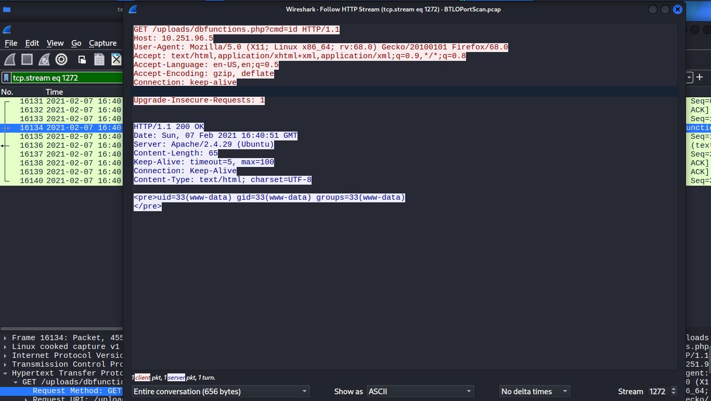

# From Port Scan to Interactive Shell

### A packet-evidence investigation of an internal web-server compromise

**Wireshark · TCP/IP · HTTP analysis · Web-shell investigation · Incident documentation**

A SYN scan exposed an HTTP service. Later traffic showed SQL injection probes, a PHP web-shell upload, successful command execution as `www-data`, and an interactive shell session. This case study follows that progression using **16 annotated evidence figures** and explicitly separates observations from inference.

> **Confirmed outcome:** command execution and interactive shell access in the web-service account context. SQL injection success, root access and data exfiltration are not established by the supplied evidence.

## Start here

- [Full investigation with screenshots](docs/INVESTIGATION.md)
- [Chronological event table](docs/timeline.csv)
- [Evidence register and SHA-256 checksums](docs/evidence-register.csv)
- [Wireshark display filters](docs/wireshark-filters.txt)

## Case at a glance

| Field | Value |
|---|---|
| Capture filename visible in evidence | `BTLOPortScan.pcap` |
| Capture activity date | 7 February 2021 |
| Main source / target | `10.251.96.4` → `10.251.96.5` |
| Web service | HTTP / TCP 80 |
| Uploaded web shell | `/uploads/dbfunctions.php` |
| Execution account | `www-data` — UID/GID 33 |
| Hostname displayed in shell prompt | `bob-appserver` |
| Requested callback destination | `10.251.96.4:4422` |
| Evidence basis | Analyst-supplied Wireshark screenshots; raw PCAP not distributed |

## Investigation sequence

| Stage | Evidence | Result |
|---|---|---|
| Reconnaissance | SYN probes and response flags | Port 80 accepts TCP connections |
| Web interaction | HTTP requests and responses | Application pages accessed |
| Injection testing | SQL-oriented payloads and sqlmap User-Agent | Testing observed; success unproven |
| File upload | PHP content, acceptance message, directory index | Web shell uploaded and listed |
| Execution | `id` and `whoami` responses | Commands run as `www-data` |
| Interactive access | Callback request and shell exchange | Interactive shell demonstrated |
| Discovery / attempted deletion | Directory output and error | Files enumerated; deletion attempt fails |

## Skills demonstrated

- Reconstructing a multi-stage sequence across TCP and HTTP streams.
- Interpreting SYN, SYN/ACK and RST patterns without equating scanning with compromise.
- Linking upload content to application feedback and subsequent command output.
- Distinguishing successful execution from an HTTP status code.
- Recording evidence references, timestamps, limitations and response priorities.

## Scope and evidence handling

The analyst performed the Wireshark investigation and supplied the screenshots. This repository organizes those observations into a portfolio case study; it does not claim an independent re-analysis of the raw capture. Credential and session-value lines have been covered with opaque redactions in public copies. Originals and the raw capture are not included. Private IP addresses are retained to preserve event relationships.

The source filename is recorded as observed. No original dataset URL, license or permission to redistribute the PCAP was supplied; no raw capture or dataset license is asserted here. This is a historical capture case study, not a claim of a live production incident response.

*Featured evidence: stream 1272 returns the execution identity. See the full report for preceding and subsequent events.*
